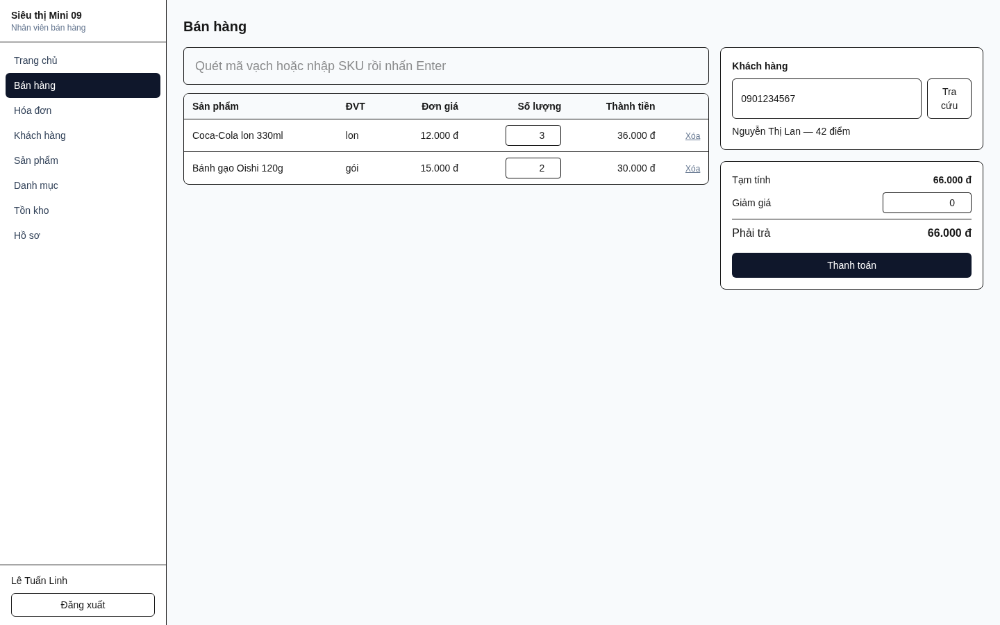
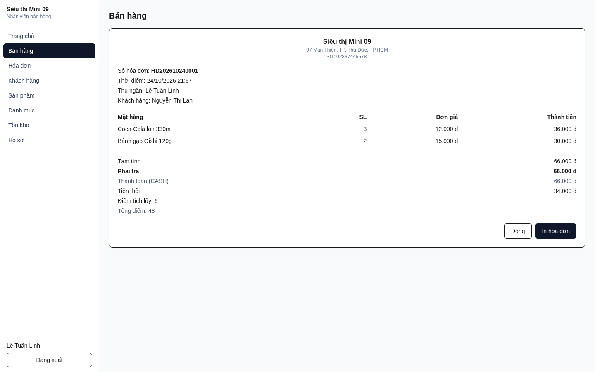
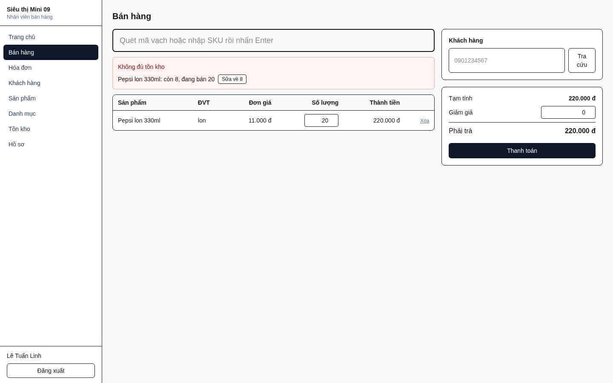
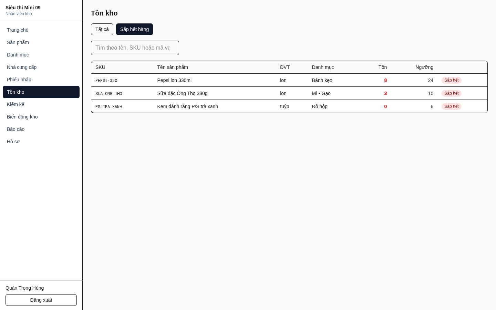
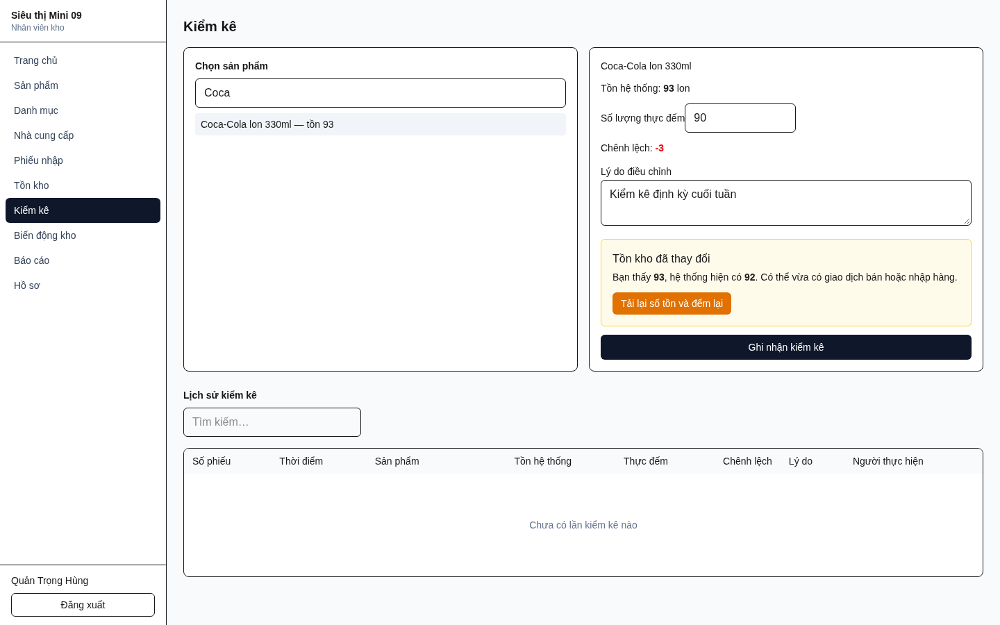
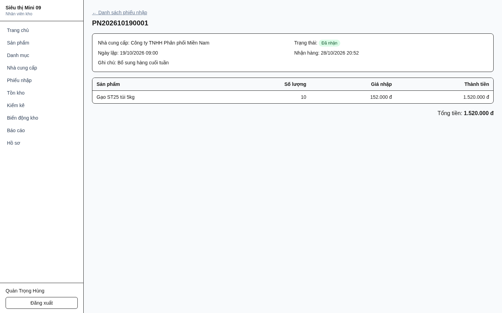
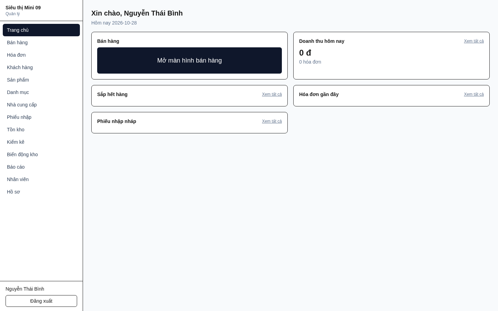
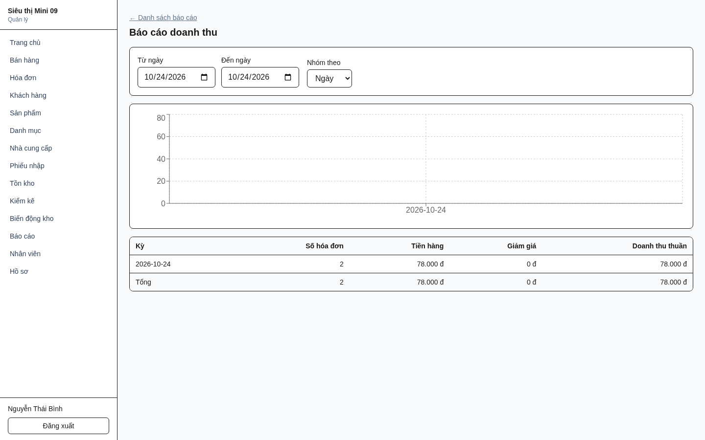
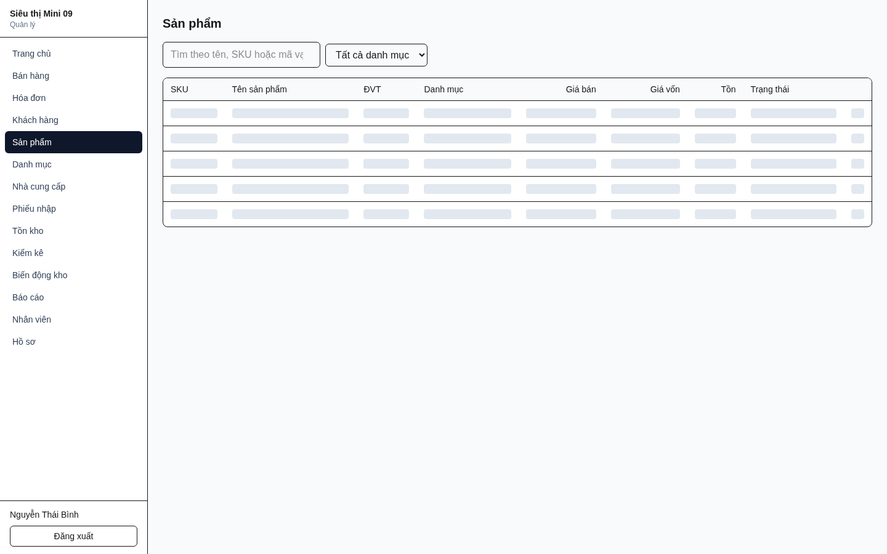
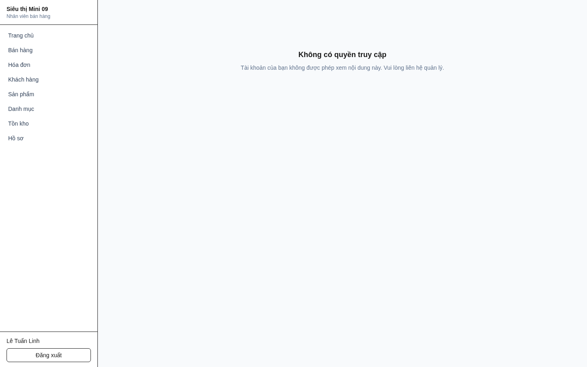

# Quản lý siêu thị — Đề 09

Hệ thống quản lý siêu thị mini: bán hàng tại quầy, quản lý hàng hóa và tồn kho, nhập hàng,
khách hàng thân thiết và báo cáo doanh thu.

Repo này chứa **frontend** (Next.js) cùng toàn bộ tài liệu phân tích — thiết kế. Backend
(NestJS + Prisma + MySQL) nằm ở repo riêng; frontend chạy độc lập được nhờ một mock có
trạng thái ngay trong trình duyệt.

```bash
cd frontend
cp .env.example .env.local
npm install && npm run dev        # http://localhost:3000
```

Đăng nhập: `admin` / `admin123` · `thungan` / `cashier123` · `thukho` / `stock123`



---

## Tính năng

Ba vai trò: **Quản lý** (toàn quyền), **Nhân viên bán hàng** (bán hàng, khách hàng),
**Nhân viên kho** (nhập hàng, tồn kho). Phân quyền kiểm tra ở máy chủ.

### Bán hàng tại quầy

Quét mã vạch hoặc SKU, thêm vào giỏ, gắn khách hàng, áp giảm giá trong hạn mức của vai
trò, thanh toán **nhiều phương thức** (tiền mặt / thẻ / chuyển khoản), in hóa đơn.

Toàn bộ thao tác chốt đơn chạy trong **một giao dịch**: kiểm tồn → chụp giá bán và giá vốn
từng dòng → phân bổ giảm giá → ghi hóa đơn → trừ tồn → ghi biến động kho → cộng điểm.
Thiếu tồn thì báo rõ *"còn 8, đang bán 20"* kèm nút sửa nhanh, và không ghi gì cả.

| Hóa đơn sau thanh toán | Chặn bán vượt tồn |
|---|---|
|  |  |

### Hàng hóa và tồn kho

Danh mục sản phẩm với SKU, mã vạch, đơn vị tính, giá bán và ngưỡng cảnh báo. Xem tồn hiện
tại, cảnh báo **sắp hết hàng**, và **kiểm kê** có phát hiện xung đột — nếu tồn thay đổi
trong lúc đang đếm, hệ thống từ chối và bắt xác nhận lại thay vì ghi đè. Mọi thay đổi tồn
đều vào **sổ biến động kho** kèm chứng từ và người thực hiện.

| Cảnh báo sắp hết hàng | Kiểm kê phát hiện xung đột |
|---|---|
|  |  |

### Nhập hàng

Lập phiếu nhập theo nhà cung cấp, lưu nháp rồi xác nhận sau. **Chỉ thao tác xác nhận nhận
hàng mới làm tăng tồn** — đồng thời tính lại **giá vốn bình quân gia quyền**. Phiếu đã nhận
là bản ghi lịch sử: không sửa, không nhận lại, không xóa.



### Khách hàng

Tra cứu theo số điện thoại hoặc mã khách ngay tại quầy, gắn vào hóa đơn, **tự động cộng
điểm** sau khi thanh toán thành công (1 điểm cho mỗi 10.000 đ, làm tròn xuống).

### Báo cáo

Doanh thu theo ngày/tháng, sản phẩm bán chạy, **lợi nhuận gộp** (doanh thu trừ giá vốn đã
chụp lúc bán), và giá trị tồn kho. Giá vốn được chụp tại thời điểm bán nên đổi giá hôm nay
không làm sai lệch báo cáo quá khứ.

| Trang chủ theo vai trò | Báo cáo doanh thu |
|---|---|
|  |  |

### Quản trị

Tạo tài khoản nhân viên, gán vai trò, khóa/mở khóa. Không có xóa cứng ở bất kỳ đâu — mọi
thứ đều là *ngừng hoạt động* để giữ lịch sử giao dịch.

Giá vốn chỉ hiện với quản lý và nhân viên kho — thu ngân không nhận được trường này từ
API. Gõ thẳng đường dẫn không có quyền sẽ ra màn hình từ chối, và màn hình đó không gọi
API nào.

| Danh sách sản phẩm (quản lý) | Chặn truy cập theo vai trò |
|---|---|
|  |  |

> Chi tiết từng màn hình, đường dẫn, vai trò truy cập và truy vết tới mã SRS (F1–F10):
> [`frontend/README.md`](frontend/README.md#tính-năng)

---

## Cấu trúc repo

| Đường dẫn | Nội dung |
|-----------|----------|
| `frontend/` | Ứng dụng Next.js + mock backend. 154 unit test, 60 kiểm thử đầu-cuối, 4 kiểm thử trên API thật. |
| `openapi.json` | Hợp đồng API — **nguồn sự thật**. |
| `api-types.ts` | Kiểu TypeScript sinh tự động từ hợp đồng. Không sửa tay. |
| `api_integration_guide.md` | Hình dạng request/response, luồng token, mã lỗi. |
| `api_usage_guide.md` | API nào dùng khi nào, ở màn hình nào, ai được gọi. |
| `docs/integration-log.md` | **Cần đọc trước khi tích hợp**: 8 sai lệch hợp đồng, 4 câu hỏi cho backend, kết quả nghiệm thu MVP. |
| `edge-cases-and-failure-modes.md` | Sổ rủi ro: 67 tình huống biên, đã phân loại mức độ. |
| `docs/superpowers/specs/` | Đặc tả thiết kế frontend. |
| `docs/superpowers/plans/` | Kế hoạch triển khai. |
| `Báo cáo đồ án CNPM_Đề 09…docx` | Tài liệu phân tích — thiết kế (SRS). |

### Chạy cùng backend thật

```bash
# 1. Backend (repo riêng, clone cạnh m1) — xem docs/integration-log.md
cd ../api-mini-store
docker compose up -d mysql && npm run start:prod

# 2. Frontend
cd m1/frontend && npm run dev:live

# 3. Kiểm thử khói trên API thật (tự bỏ qua nếu backend chưa chạy)
npm run test:e2e:live
```

Tài khoản, cấu hình và toàn bộ sai lệch đã phát hiện:
[`docs/integration-log.md`](docs/integration-log.md).

## Kiểm thử (dành cho QA)

Hệ thống có **hai backend**: mock chạy ngay trong trình duyệt (mặc định, không cần
Docker) và API thật. Hai chế độ trả lời hai câu hỏi khác nhau — cần chạy cả hai.

| Câu hỏi | Lệnh | Cần backend? |
|---|---|---|
| Giao diện có tự nhất quán không? | `npm run verify` + `npm run test:e2e` | **Không** |
| Giao diện có khớp với API thật không? | `npm run test:e2e:live` | **Có** |

> Mock **không** chứng minh được tính tương thích với backend. Đã có tiền lệ: toàn bộ
> 154 unit test và 60 e2e test đều xanh trong khi frontend đọc sai phong bì lỗi của API
> — mọi mã lỗi rơi về thông báo chung. Chỉ chạy trên API thật mới lộ ra.

### A. Kiểm thử tự động

```bash
cd frontend
npm run verify        # kiểm tra kiểu + 154 unit test (~2 giây)
npm run test:e2e      # 60 kiểm thử đầu-cuối trên mock (~2 phút)
npm run test:e2e:report   # như trên, kèm báo cáo HTML để đọc kết quả
```

Trên API thật — xem mục *Chạy cùng backend thật* để dựng backend trước:

```bash
npm run test:e2e:live     # 4 bài, phủ cả 8 luồng nghiệm thu (~1,5 phút)
```

Nếu backend chưa chạy, lệnh này **tự bỏ qua** kèm hướng dẫn, không báo đỏ.

`npm run test:e2e` kết thúc với **60 passed, 5 skipped** — đúng như mong đợi, không phải
lỗi. Năm bài bị bỏ qua gồm 4 bài chỉ chạy trên API thật và 1 bài chụp ảnh màn hình chỉ
chạy khi được yêu cầu (`npm run screenshots`), để nó không tự ghi đè ảnh trong repo.

**Lưu ý quan trọng khi chạy**: nếu đang có `npm run dev` hoặc `npm run dev:live` mở sẵn
ở cổng 3000, Playwright sẽ dùng lại server đó — và bộ kiểm thử sẽ chạy **sai chế độ**
mà không báo gì. Trước khi kết luận một lần chạy, hãy đảm bảo cổng 3000 đang trống:

```bash
curl -s -o /dev/null -w "%{http_code}\n" --max-time 2 http://localhost:3000/   # mong đợi 000
```

### B. Kiểm thử thủ công — tám luồng nghiệm thu

Đây là định nghĩa "chạy được" của hệ thống. Làm trên **API thật**
(`npm run dev:live`), tài khoản ở [`docs/integration-log.md`](docs/integration-log.md).

| # | Luồng | Đạt khi |
|---|-------|---------|
| 1 | Đăng nhập ba vai trò | Quản lý → trang chủ · Thu ngân → POS · Kho → tồn kho; tài khoản bị khóa bị từ chối |
| 2 | Bán hàng | Quét SKU, gắn khách bằng SĐT, thanh toán → hóa đơn có số `HD…` thật và số điểm vừa cộng |
| 3 | Giao dịch có thật | Tồn giảm đúng số đã bán · hóa đơn vào **Hóa đơn** · điểm khách tăng |
| 4 | Nhập hàng | Phiếu nháp → **Đã nhận**; tồn tăng; có dòng `PURCHASE` trong **Biến động kho** |
| 5 | Kiểm kê | Nhập số đếm lệch kèm lý do → tồn được điều chỉnh, có dòng `ADJUSTMENT` |
| 6 | Báo cáo | Doanh thu hôm nay phản ánh đúng hóa đơn vừa tạo |
| 7 | Phân quyền | Thu ngân **không** thấy cột *Giá vốn*; gõ thẳng `/reports/revenue` hay `/users` → màn hình từ chối |
| 8 | Phiên đăng nhập | Token hết hạn (60 giây) → làm việc tiếp vẫn bình thường, **không** bị đăng xuất |

Luồng 8 là luồng dễ hỏng nhất và cũng dễ bỏ sót nhất: bảy luồng kia có thể đạt trong khi
nó hỏng. Một máy bán hàng đá thu ngân ra mỗi phút thì không dùng được.

### C. Quy tắc nghiệp vụ nên kiểm bằng tay

Những con số này có thể tự tính để đối chiếu:

| Kiểm | Thao tác | Kỳ vọng |
|---|---|---|
| Chặn bán vượt tồn | Bán nhiều hơn số tồn | Báo *"còn N, đang bán M"* kèm nút sửa; **không** tạo hóa đơn |
| Trần giảm giá | Thu ngân giảm > 10% | Bị từ chối kèm mức tối đa; cùng mức đó quản lý lại được |
| Tích điểm | Hóa đơn 36.000 đ có gắn khách | Đúng **3** điểm (1 điểm mỗi 10.000 đ, làm tròn xuống) |
| Giá vốn bình quân | Nhập thêm với giá khác | `(tồn cũ × giá cũ + SL nhập × giá nhập) / tổng SL`, 2 chữ số thập phân |
| Xung đột kiểm kê | Mở màn kiểm kê, bán 1 ở cửa sổ khác, rồi ghi nhận | Bị chặn, hiện **cả hai** con số, không điều chỉnh gì |
| In lại hóa đơn | Bấm *In lại* nhiều lần | Tồn không đổi, **không** phát sinh hóa đơn thứ hai |
| Khoảng ngày báo cáo | Chọn ngày kết thúc **trước** ngày bắt đầu một ngày | Báo lỗi tiếng Việt và **không gửi request nào** |

### D. Những điểm đã biết — không cần báo lỗi

- **Chưa có chức năng sửa**: sản phẩm, danh mục, nhà cung cấp, khách hàng, nhân viên
  đều chưa có form sửa; sản phẩm và danh mục cũng chưa có form thêm. Đang ở giai đoạn 2.
- **Giới hạn đăng nhập 5 lần/60 giây/IP**: lần thứ 6 trả `429` và hiện **giống hệt**
  sai mật khẩu. Chờ một phút rồi thử lại trước khi kết luận.
- **Không có hủy/hoàn hóa đơn**, không quản lý lô và hạn dùng, không bán hàng cân lẻ —
  nằm ngoài phạm vi phiên bản đầu theo SRS.
- **Ảnh chụp màn hình trang chủ** trong README hiện trống do chụp đúng lúc đang tải —
  lỗi đã biết, không phải lỗi chức năng.

### E. Báo lỗi

Kèm theo: vai trò đang đăng nhập, chế độ (`dev` hay `dev:live`), các bước tái hiện,
và **`requestId`** trong phản hồi lỗi nếu có — backend ghi log theo mã này.

---

## Trạng thái

Mười lăm màn hình chạy được trên mock **và đã tích hợp xong với backend thật**: cả tám
luồng nghiệm thu đều đạt trên dữ liệu thật (117 sản phẩm, 1200 hóa đơn). Chi tiết kết quả
và tám sai lệch hợp đồng đã xử lý: [`docs/integration-log.md`](docs/integration-log.md).

Còn thiếu phần **sửa** của bốn chức năng (F2 nhân viên, F3 sản phẩm và danh mục, F4 nhà
cung cấp, F7 khách hàng), phần **thêm** của F3, và sửa phiếu nhập nháp. Tầng dữ liệu và
mock đã sẵn sàng cho tất cả — chi tiết ở [`frontend/README.md`](frontend/README.md#chưa-làm).
